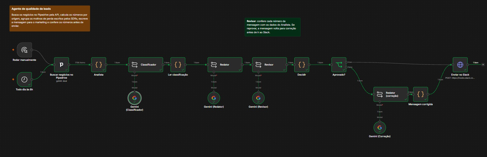
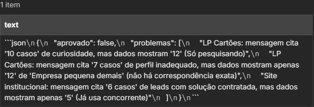
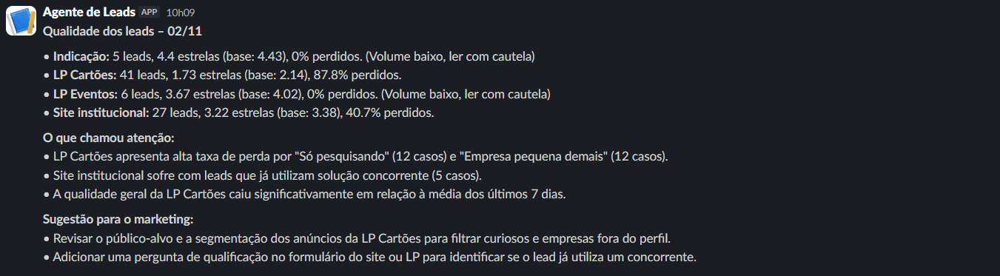

# Agente de leads

Agente de IA construído no n8n que lê o CRM, cruza a origem de cada lead com a nota dada pelo SDR e com o motivo de descarte, e envia ao time de marketing um resumo diário no Slack.

Nasceu de um problema que vivi como SDR na VExpenses: a percepção sobre a qualidade dos leads de cada landing page chegava ao marketing de forma indireta, passando por várias pessoas. Os dados usados aqui são fictícios.

## Como funciona

1. **Busca os negócios no Pipedrive**, pela API, com origem, estrelas, status e observações do SDR.
2. **O Analista calcula os números** em código, sem IA: leads, média de estrelas e % de perdidos por origem, comparados com os 7 dias anteriores.
3. **O Classificador** (Gemini) agrupa o texto livre dos SDRs em motivos de perda, como "só pesquisando" ou "empresa pequena demais".
4. **O Redator** (Gemini) escreve a mensagem para o marketing, com aviso quando o volume é baixo demais para concluir.
5. **O Revisor** (Gemini) compara cada número da mensagem com os dados do Analista. Se encontrar erro, a mensagem volta para correção.
6. **A mensagem vai para o Slack**, no canal do marketing, todo dia às 8h.

As contas ficam com o código, não com a IA. O Classificador e o Revisor respondem em JSON, para o fluxo ler a saída sem interpretar texto.

## O Revisor em ação

Na execução de exemplo, o Redator errou dois números. O Revisor reprovou a mensagem, apontou os erros, e a versão corrigida foi a enviada.

## Arquivos

- [`fluxo/agente-de-leads.json`](fluxo/agente-de-leads.json): o fluxo completo, pronto para importar no n8n.
- [`prompts.md`](prompts.md): os prompts de cada agente.

## Como usar

1. No n8n, importe `fluxo/agente-de-leads.json`.
2. Configure as credenciais do Pipedrive e do Google Gemini nos nós correspondentes.
3. No nó "Enviar no Slack", troque `COLE_AQUI_A_URL_DO_WEBHOOK_DO_SLACK` pela URL de um Incoming Webhook do seu Slack.
4. Os campos personalizados do Pipedrive (data de entrada, estrelas, origem e reunião agendada) são lidos pelas chaves definidas no início do nó "Analista". Ajuste para as chaves da sua conta.

## Ferramentas

n8n, API do Pipedrive, API do Gemini e Slack.

---

Feito por [Rafael Augusto Barbosa da Rocha](https://www.linkedin.com/in/rafael-rocha02/).
